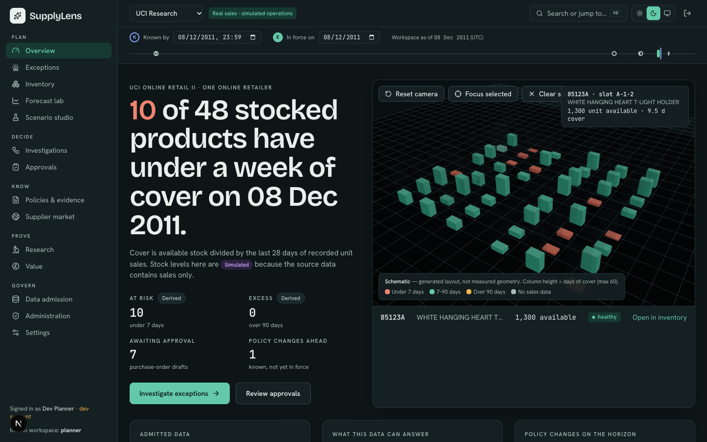
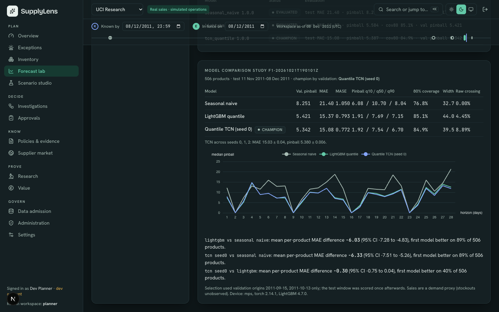
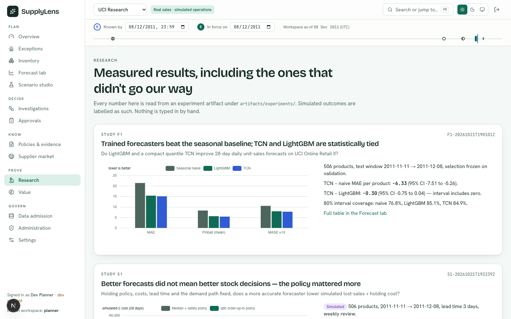
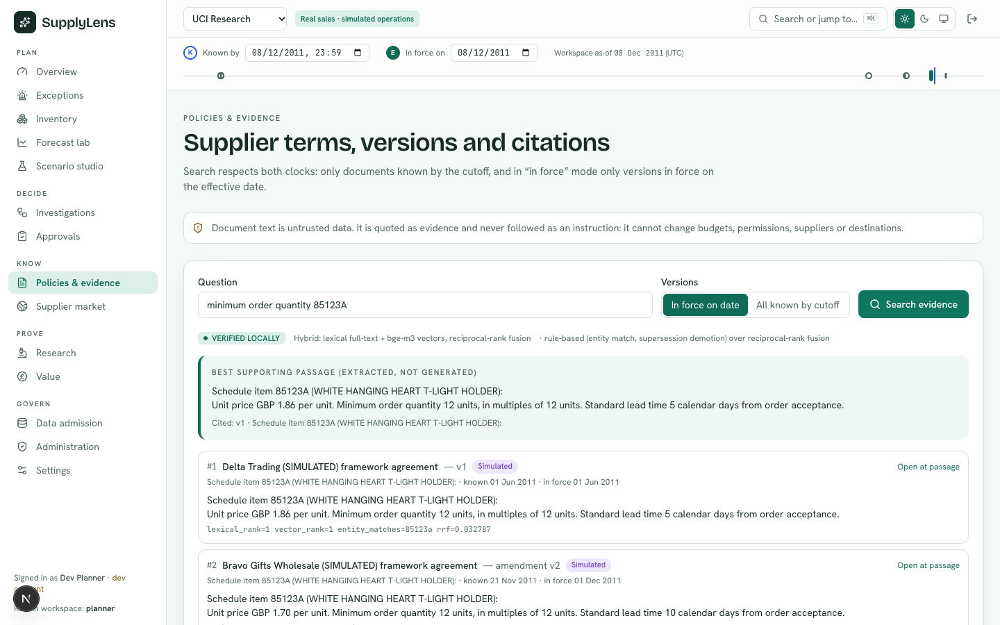
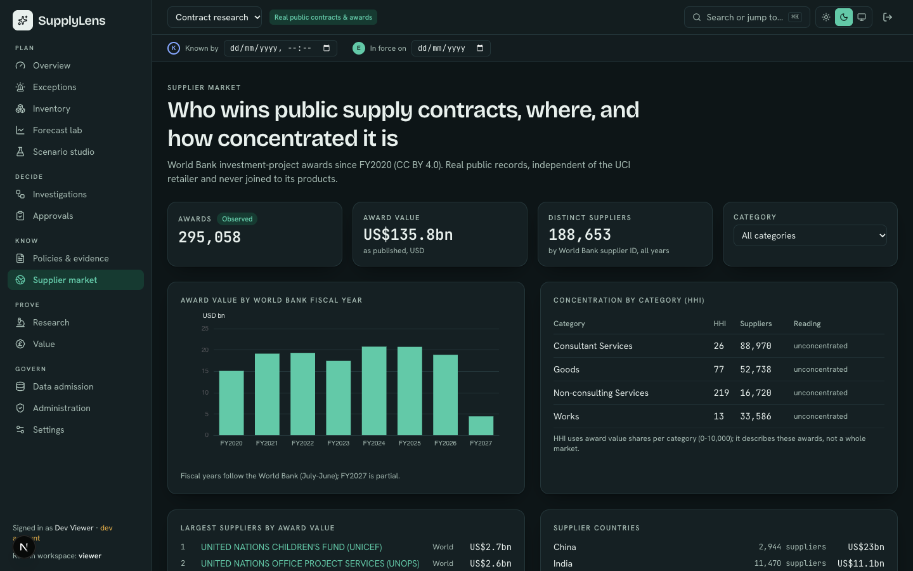

<div align="center">

# SupplyLens

**Evidence-grounded inventory and procurement decisions**

Trained demand forecasts · time-aware supplier-policy evidence · constrained replenishment planning ·
approval-bound purchase orders that are reconciled before they count as done.

 
 




</div>

## Why SupplyLens

Planners need to know *what to order, from whom, and why* — and to prove it later. SupplyLens connects real
sales history, the supplier terms that were actually in force on the decision date, and an optimiser that never
invents a plan. Every recommendation carries an evidence packet (data cutoff, forecast version, cited contract
clause, constraint checks), every external write needs a bound approval, and every order is read back from the
target system before it is marked complete.

## Highlights

- **Two clocks for every decision** — *known by* (knowledge cutoff) and *in force on* (effective date), so
  historical replays never use documents that arrived later and amendments apply only from their effective date.
- **Trained forecasting** — LightGBM quantile and a compact quantile TCN, evaluated against seasonal naive on a
  frozen chronological protocol; artifacts are hash-verified before serving.
- **Deterministic planning** — OR-Tools CP-SAT with MOQ, pack multiples, lead times, budget and capacity, an
  independent validator, and explanations when a plan is infeasible.
- **Hybrid temporal retrieval** — PostgreSQL full-text + local `bge-m3` vectors, reciprocal-rank fusion,
  supersession-aware reranking (optional cross-encoder, off by default and unevaluated), abstention when the evidence is missing.
- **Lead-time-demand replenishment** — order-up-to level is the service-level quantile of demand over lead time + coverage,
  with day-to-day dependence measured from the SKU's own sales (simulation-checked, not yet validated on real history).
- **Controlled execution** — stateful LangGraph investigator, approvals bound to payload hash and expiry,
  separation of duties, transactional outbox, idempotent sandbox ERP, unknown-outcome reconciliation.
- **Multi-tenant by construction** — forced row-level security on 38 tables, non-owner database role,
  CSRF protection, atomic idempotency keys, database-shared rate limits, append-only audit trail, verified tenant
  export and certified deletion.
- **Operable** — alert queue with signed webhook, OpenTelemetry tracing, WAL archiving with a rehearsed point-in-time
  recovery, load-tested on a 100,000-chunk / 1,000,000-row reference data set ([`docs/operations/load-test.md`](docs/operations/load-test.md)).
- **Interface** — 15 screens, linked 3D/2D/table inventory, live investigation stream, ⌘K command palette,
  Light/Dark/System themes, WCAG-checked with axe on desktop and mobile.

| Forecast lab | Research results |
|---|---|
|  |  |
| **Policies & evidence** | **Supplier market** |
|  |  |

## Measured results

All figures come from experiment artifacts in `artifacts/experiments/` (status of each run: `evaluations/study_registry.json`); details in
[`docs/research/results.md`](docs/research/results.md).

| Study | Result |
|---|---|
| Forecasting (protocol 2.0.0, 503 products, two rolling 28-day test origins) | Pooled MAE: seasonal naive 21.35 → LightGBM 14.52 → quantile TCN 14.26; trained models beat the corrected baseline (95% CI excludes 0); TCN ahead of LightGBM on average (−0.27, CI −0.52 to −0.06) but on only 44% of products. Protocol 1.0.0 is superseded: its baseline was wrong beyond day 7 |
| Inventory simulation (simulated costs, exploratory) | Lower forecast error did not lower simulated cost under a median policy; a q90 order-up-to policy brought fill to ≈95% for every model (policy chosen after seeing results) |
| Time-aware retrieval (118 synthetic questions, 2×2) | Top-1 citation accuracy 92.6% with neither mechanism → 100% with effective-date filtering and supersession reranking; each contributes (+3.2 and +4.2 points) |
| Clause localisation (73 CUAD contracts) | Hybrid hit@3 76.7% vs vector 72.2% vs lexical 66.8% |
| InventoryBench (official evaluator, 1,320 instances) | SupplyLens policy 0.482 vs base-stock 0.433 |
| Investigator scenarios | 57 scenarios × 3 trials, 100% oracle-verified, 0 unapproved external writes |

Negative results are kept: vector-only retrieval beats the hybrid on ACORD, and accuracy-optimal medians
under-stock on heavy-tailed sales.

## Data

| Workspace | Sources | Labels |
|---|---|---|
| UCI Research | UCI Online Retail II — 1,067,371 rows, reconciled to the row (CC BY 4.0) + simulated stock, suppliers and agreements | Observed / Simulated |
| Contract research | ACORD clauses, 73 CUAD supply agreements with 2,176 expert labels, 295,058 World Bank awards (CC BY 4.0) | Observed |
| Demo | Fictional fixtures and a reference policy-change case | Synthetic |

Datasets are never joined across domains, raw files are immutable and hashed, and simulated values are labelled
everywhere they appear. Raw data is not committed; see `scripts/download_datasets.py`.

## Architecture

```
apps/web/            Next.js 16, TypeScript, Tailwind 4, ECharts, React Three Fiber
services/api/        FastAPI, Pydantic v2, SQLAlchemy 2, Alembic, psycopg 3
services/worker/     PostgreSQL job queue (SKIP LOCKED, leases, fencing) + outbox dispatcher
ml/                  Data adapters, LightGBM quantile, quantile TCN (PyTorch), metrics
optimisation/        CP-SAT planner, validator, temporal terms resolution, replenishment
evaluations/         Frozen studies: forecasting, simulation, retrieval, InventoryBench, agent
packages/contracts/  OpenAPI document + generated TypeScript types (drift-checked)
infra/               Dockerfiles, PostgreSQL bootstrap; docker-compose.yml; CI workflow
```

## Getting started

Requirements: PostgreSQL 17 with pgvector, [uv](https://docs.astral.sh/uv/), Node 20+, optionally Ollama with `bge-m3`.

```bash
cp .env.example .env && ./scripts/dev_db.sh && uv sync
uv run alembic -c services/api/alembic.ini upgrade head
python3 scripts/download_datasets.py --dataset online_retail_ii
uv run python -m supplylens.bootstrap
uv run python evaluations/forecast_study.py

uv run uvicorn supplylens.api.app:app --port 8000      # API
uv run python -m supplylens_worker.main                 # worker
npm --prefix apps/web install && npm --prefix apps/web run dev   # http://localhost:3100
```

Full setup, backup/restore and operating procedures: [`docs/operations/runbook.md`](docs/operations/runbook.md).

## Testing

```bash
uv run pytest -q                       # 398 passed, 6 skipped (Keycloak) against real PostgreSQL, incl. migration/rollback/outage rehearsals
(cd apps/web && npx playwright test)   # 116 browser tests (114 pass, 2 skip): journeys, resilience, accessibility, Web Vitals, layout
uv run ruff check .                    # correctness, imports, bugbear and security rules
./scripts/check_contracts.sh           # API contract drift (the web client is typed from it)
./scripts/backup_restore_drill.sh      # logical restore rehearsal with hash verification
./scripts/pitr_drill.sh                # point-in-time recovery rehearsal on a scratch cluster
uv run python scripts/loadtest/seed_reference.py && scripts/loadtest/run_reference.sh   # ARC-07 reference workload
```

## Project status

A complete controlled product, verified locally and in CI. Not production-ready: OIDC works against a local Keycloak but
is not qualified against a corporate identity provider, there is no real ERP connector, no production environment and
no pilot. The production-readiness program's audit, issue register and evidence are in
[`docs/agent-handoff/`](docs/agent-handoff/STATUS.md). See [`PROJECT_STATUS.md`](PROJECT_STATUS.md) and the
[acceptance register](docs/acceptance/acceptance_register.csv).

## Acknowledgements

UCI Online Retail II (Chen, 2012, doi:10.24432/C5CG6D); ACORD and CUAD (The Atticus Project); World Bank IPF
contract awards; InventoryBench (Peng et al.). Public datasets are used under CC BY 4.0 with attribution.

© 2026 Krishna Mathur. All rights reserved.
