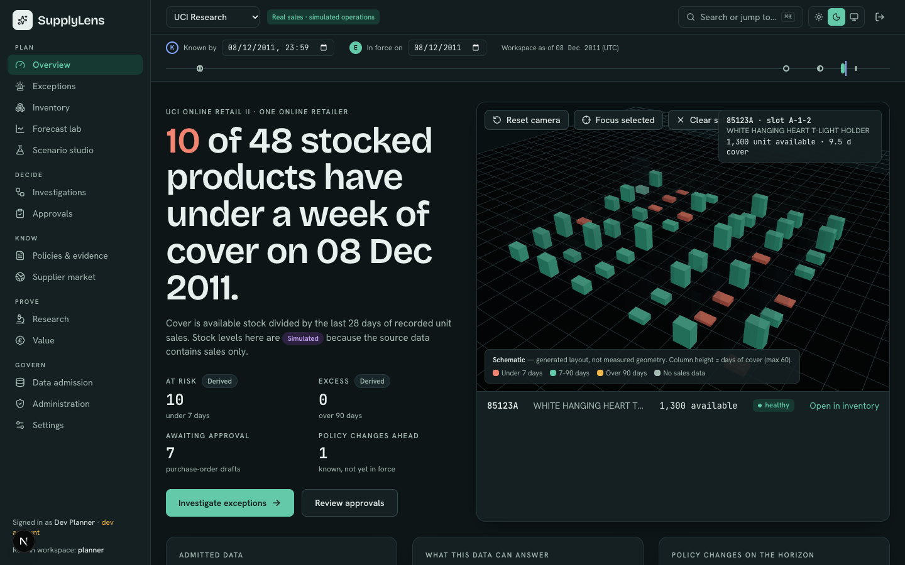
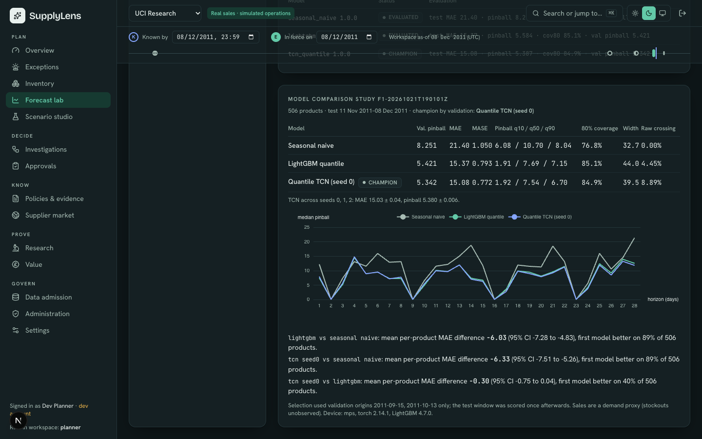
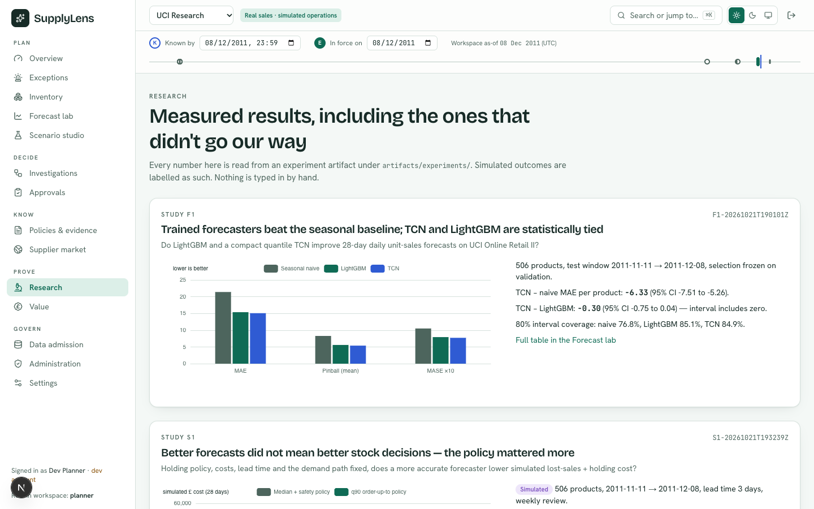
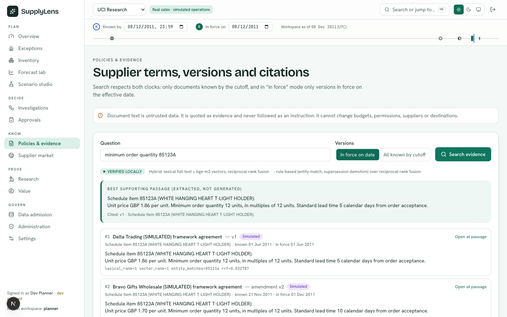
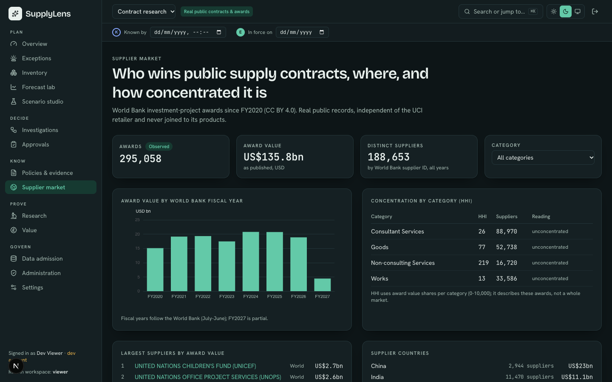

<div align="center">

# SupplyLens

**Evidence-grounded inventory and procurement decisions**

Trained demand forecasts · time-aware supplier-policy evidence · constrained replenishment planning ·
approval-bound purchase orders that are reconciled before they count as done.

 
 
<!-- source: docs/agent-handoff/EVIDENCE.md P8-E02 (uv run pytest -q; npx playwright test --list) -->



</div>

## Why SupplyLens

Planners need to know *what to order, from whom, and why* — and to prove it later. SupplyLens connects real
sales history, the supplier terms that were actually in force on the decision date, and an optimiser that never
invents a plan. Every recommendation carries an evidence packet (data cutoff, forecast version, cited contract
clause, constraint checks), every external write needs a bound approval, and every order is read back from the
target system before it is marked complete.

## Highlights

- **Two clocks for every decision** — *known by* (knowledge cutoff) and *in force on* (effective date), so
  historical replays never use documents that arrived later and amendments apply only from their effective date.
- **Trained forecasting** — LightGBM quantile and a compact quantile TCN, evaluated against seasonal naive on a
  frozen chronological protocol; artifacts are hash-verified before serving.
- **Deterministic planning** — OR-Tools CP-SAT with MOQ, pack multiples, lead times, budget and capacity, an
  independent validator, and explanations when a plan is infeasible.
- **Hybrid temporal retrieval** — PostgreSQL full-text + local `bge-m3` vectors, reciprocal-rank fusion,
  supersession-aware reranking (optional cross-encoder, off by default and unevaluated), abstention when the evidence is missing.
- **Lead-time-demand replenishment** — order-up-to level is the service-level quantile of demand over lead time + coverage,
  with day-to-day dependence measured from the SKU's own sales (simulation-checked, not yet validated on real history).
- **Controlled execution** — stateful LangGraph investigator, approvals bound to payload hash and expiry,
  separation of duties, transactional outbox, unknown-outcome reconciliation; an ERP adapter contract with an outage
  circuit breaker, receipt and order-status synchronisation and cancellation, verified against a local sandbox ERP
  (no real ERP is connected).
- **Multi-tenant by construction** — forced row-level security on 40 tables <!-- source: pg_class.relforcerowsecurity on a database at migration 0011, counted 2026-11-10 (P8-E02) -->, non-owner database role,
  CSRF protection, atomic idempotency keys, database-shared rate limits, append-only audit trail, verified tenant
  export and certified deletion.
- **Operable** — alert queue with signed webhook, OpenTelemetry tracing, WAL archiving with a rehearsed point-in-time
  recovery, admission control with 503/429 + Retry-After, token-protected Prometheus metrics, load-tested on a
  100,000-chunk / 1,000,000-row reference data set <!-- source: docs/operations/load-test.md --> ([`docs/operations/load-test.md`](docs/operations/load-test.md)).
- **Inventory classes** — ABC (365-day value) and XYZ (52-week variability) classes, safety stock z·σ·√L and a
  cost-of-service curve on the Inventory screen.
- **Cost, service and CO2** — an optional CO2 cap on the plan (ε-constraint; lane factors and unit weights assumed) and
  the exact cost/service/CO2 frontier in the Scenario studio; purchasing stays deterministic and approval-gated.
- **Generated answers, local only** — a local model (Ollama `qwen2.5:7b`, temperature 0) may phrase an answer only after
  retrieval finds passages in force, every sentence cites a passage and every figure appears in it; otherwise the
  answer is withheld. Off unless `SUPPLYLENS_GENERATION_ENABLED` is set; the public demo profile refuses to start with
  it on (D-094, D-041).
- **n8n agent** — an n8n workflow with planner rights only turns shortages into draft orders; people approve (D-099).
- **Interface** — 15 screens, linked 3D/2D/table inventory, live investigation stream, ⌘K command palette,
  Light/Dark/System themes, WCAG-checked with axe on desktop and mobile.

| Forecast lab | Research results |
|---|---|
|  |  |
| **Policies & evidence** | **Supplier market** |
|  |  |

## Measured results

All figures come from experiment artifacts in `artifacts/experiments/` (status of each run: `evaluations/study_registry.json`); details in
[`docs/research/results.md`](docs/research/results.md).

| Study | Result |
|---|---|
| Forecasting (protocol 2.1.0, 503 products, two rolling 28-day test origins) <!-- source: artifacts/experiments/F1-20261023T180239Z/metrics.json --> | Pooled MAE: seasonal naive 21.35 → LightGBM 14.52 → quantile TCN 14.32; trained models beat the baseline (95% CI excludes 0); TCN and LightGBM not clearly different (−0.20, CI −0.46 to +0.03). 2.0.0 is superseded (its TCN never saw weekdays), 1.0.0 too (baseline wrong beyond day 7) |
| Decisions through the product's ordering logic (simulated, exploratory) <!-- source: artifacts/experiments/S2-20261023T183015Z/metrics.json --> | Without a budget limit a no-forecast base-stock rule was cheapest; TCN not clearly different from seasonal naive; LightGBM clearly more expensive despite lower MAE. Better accuracy did not mean better simulated decisions |
| Answer support (535 generated questions) <!-- source: artifacts/experiments/R3-20261023T181121Z/metrics.json --> | Ambiguous multi-supplier questions are no longer answered with one clause; ~40% of out-of-scope questions declined; 30% of reworded questions now listed as related passages instead of answered |
| Time-aware retrieval (118 synthetic questions, 2×2) <!-- source: artifacts/experiments/R2-20261022T045503Z/metrics.json --> | Top-1 citation accuracy 92.6% with neither mechanism → 100% with effective-date filtering and supersession reranking; each contributes (+3.2 and +4.2 points) |
| Clause localisation (73 CUAD contracts, 485 contract-category items) <!-- source: artifacts/experiments/C1-20261021T191800Z/metrics.json --> | Hybrid hit@3 76.7% vs vector 72.2% vs lexical 66.8% |
| InventoryBench (official evaluator, 600 instances scored) <!-- source: artifacts/experiments/IB-20261021T192006Z/metrics.json "instances"; earlier text said 1,320 (DOC-P8-01) --> | SupplyLens policy 0.482 vs base-stock 0.433 |
| Investigator scenarios <!-- source: artifacts/experiments/AGT-20261022T045832Z/metrics.json --> | 57 scenarios × 3 trials, 100% oracle-verified, 0 unapproved external writes |

### Operations studies

Added in Phase 7 (2026-10-26/27 and 2026-10-30). The kind of each number is stated; none is a real business outcome.
Course documents quote these values only from [`docs/course/metrics.md`](docs/course/metrics.md), generated from the
same files.

| Study | Result | Kind of number |
|---|---|---|
| E1 cost, service and CO2 <!-- source: artifacts/experiments/E1-20261026T200641Z/metrics.json --> | Under the £20,000 weekly budget a 5 % CO2 cut costs 9 of 23,980 units (4,565 → 4,574 short); halving CO2 costs 13.8 points of coverage (registry headline). NSGA-II reaches 98.07–98.49 % of the exact front's hypervolume | Simulation: real UCI scope; terms, stock, lanes, CO2 factors and unit weights assumed |
| FA1 fair allocation <!-- source: artifacts/experiments/FA1-20261026T200912Z/metrics.json --> | Best group 82.5 % coverage, worst 50.81 % (gap 31.69 points); reweighing at α 0.4 cuts the gap to 12.24 points for 1.39 points of total coverage; full reweighing over-corrects | Simulation: real country shares; stock, terms and budget simulated |
| W1 error measures and weather <!-- source: artifacts/experiments/W1-20261027T055557Z/metrics.json --> | Total daily units, WAPE: seasonal naive 29.74 %, Prophet 28.04 %, XGBoost 24.55 %; London weather makes no clear difference to either model | Historical backtest (UCI sales, Open-Meteo weather) |
| D1 supplier delay risk <!-- source: artifacts/experiments/D1-20261027T053410Z/metrics.json --> | AUC: supplier's past late rate 0.692, logistic regression 0.7674, LightGBM 0.7549 | Simulation: generated order history (method check) |
| G1 generated answers <!-- source: artifacts/experiments/G1-20261027T061059Z/metrics.json --> | Answerable 108/108 and reworded 88/88 answered with every figure in a cited passage; out-of-scope 0/48 answered; ambiguous 1/9 answered; supplier-only questions 0/8 answered (over-refusal, KNOW-P7-01) | Offline evaluation with generated labels; local model, off in the demo |
| JS1 receiving-floor scheduling <!-- source: artifacts/experiments/JS1-20261030T191602Z/metrics.json --> | Dispatch rules give schedules 11.11–13.0 % longer than CP-SAT on average; CP-SAT proved 7 of 9 optimal; ft06 solved to its known optimum (55) | Simulation: real UCI volumes; routes and times assumed |
| PM1 predictive maintenance <!-- source: artifacts/experiments/PM1-20261030T192104Z/metrics.json --> | AI4I 2020: LightGBM AUC 0.9795 catches 61 of 71 test failures with 135 inspections, £40,250 vs £142,000 running to failure (assumed costs); simulated fleet: a 1D-CNN (RMSE 19.25 cycles) does not beat ridge (18.9) | Published synthetic dataset (AI4I 2020) and simulation |
| QC1 visual inspection <!-- source: artifacts/experiments/QC1-20261030T193358Z/metrics.json --> | CNN AUC 0.9972 vs hand-made features 0.9462; checking only what the CNN flags catches 98.72 % of defects at £419.40 vs £900 inspecting everything (assumed costs) | Simulation: generated images |

Negative results are kept: vector-only retrieval beats the hybrid on ACORD; accuracy-optimal medians under-stock on
heavy-tailed sales; lower forecast error did not mean lower simulated cost (S2); weather adds nothing clear (W1); the
1D-CNN does not beat a ridge baseline for remaining life (PM1).

## Data

| Workspace | Sources | Labels |
|---|---|---|
| UCI Research | UCI Online Retail II — 1,067,371 rows <!-- source: docs/research/model_and_data_cards.md -->, reconciled to the row (CC BY 4.0) + simulated stock, suppliers and agreements | Observed / Simulated |
| Contract research | ACORD clauses, 73 CUAD supply agreements with 2,176 expert labels, 295,058 World Bank awards <!-- source: docs/research/model_and_data_cards.md --> (CC BY 4.0) | Observed |
| Demo | Fictional fixtures and a reference policy-change case | Synthetic |
| Studies only | UCI AI4I 2020 (CC BY 4.0, synthetic machine data), Open-Meteo London weather (CC BY 4.0), generated goods-in images | Published / Observed weather / Synthetic |

Datasets are never joined across domains, raw files are immutable and hashed, and simulated values are labelled
everywhere they appear. Raw data is not committed; see `scripts/download_datasets.py`.

## Architecture

```
apps/web/            Next.js 16, TypeScript, Tailwind 4, ECharts, React Three Fiber
services/api/        FastAPI, Pydantic v2, SQLAlchemy 2, Alembic, psycopg 3
services/worker/     PostgreSQL job queue (SKIP LOCKED, leases, fencing) + outbox dispatcher
ml/                  Data adapters, LightGBM quantile, quantile TCN (PyTorch), metrics
optimisation/        CP-SAT planner, validator, temporal terms resolution, replenishment
evaluations/         Frozen studies: forecasting, simulation, retrieval, InventoryBench, agent
packages/contracts/  OpenAPI document + generated TypeScript types (drift-checked)
infra/               Dockerfiles, PostgreSQL bootstrap; docker-compose.yml; CI workflow
```

## Getting started

Requirements: PostgreSQL 17 with pgvector, [uv](https://docs.astral.sh/uv/), Node 20+, optionally Ollama with `bge-m3`.

```bash
cp .env.example .env && ./scripts/dev_db.sh && uv sync
uv run alembic -c services/api/alembic.ini upgrade head
python3 scripts/download_datasets.py --dataset online_retail_ii
uv run python -m supplylens.bootstrap
uv run python evaluations/forecast_study.py

uv run uvicorn supplylens.api.app:app --port 8000      # API
uv run python -m supplylens_worker.main                 # worker
npm --prefix apps/web install && npm --prefix apps/web run dev   # http://localhost:3100
```

Full setup, backup/restore and operating procedures: [`docs/operations/runbook.md`](docs/operations/runbook.md). ERP
boundary and what qualifying a real ERP needs: [`erp-integration.md`](docs/operations/erp-integration.md); proposed service
levels and measured recovery: [`slo.md`](docs/operations/slo.md); incidents, support, onboarding and releases:
[`service-management.md`](docs/operations/service-management.md).

## Testing

```bash
uv run pytest -q                       # 534 passed, 6 skipped (Keycloak) against real PostgreSQL, incl. migration/rollback/outage rehearsals
(cd apps/web && npx playwright test)   # 307 browser tests on 8 projects: journeys, resilience, a11y, theme, layout, 44 screenshots, 18 lab vitals; Chromium, WebKit, Firefox
(cd apps/web && npm run lint && npm test)   # ESLint (zero warnings) and 28 unit/component tests
uv run python scripts/course_metrics.py --check   # course numbers (docs/course/metrics.md) match the study registry
uv run ruff check .                    # correctness, imports, bugbear and security rules
./scripts/check_contracts.sh           # API contract drift (the web client is typed from it)
./scripts/backup_restore_drill.sh      # logical restore rehearsal with hash verification
./scripts/pitr_drill.sh                # point-in-time recovery rehearsal on a scratch cluster
./scripts/recovery_drill.sh            # measured RPO/RTO for primary disk loss (copies a local database read-only)
./scripts/outage_drill.sh              # database outage + worker crash with orders in flight
uv run python scripts/loadtest/seed_reference.py && scripts/loadtest/run_reference.sh   # ARC-07 reference workload
```

## Project status

A complete controlled product, verified locally and in CI, and the group project for the MAIB unit *AI in Operations*
(course documents in [`docs/course/`](docs/course/), with an AI-use statement). Not production-ready: OIDC works against a local Keycloak but
is not qualified against a corporate identity provider, there is no real ERP connector, no production environment and
no pilot. The production-readiness program's audit, issue register and evidence are in
[`docs/agent-handoff/`](docs/agent-handoff/STATUS.md). See [`PROJECT_STATUS.md`](PROJECT_STATUS.md) and the
[acceptance register](docs/acceptance/acceptance_register.csv).

## Acknowledgements

UCI Online Retail II (Chen, 2012, doi:10.24432/C5CG6D); ACORD and CUAD (The Atticus Project); World Bank IPF
contract awards; InventoryBench (Peng et al.). Public datasets are used under CC BY 4.0 with attribution.

© 2026 Krishna Mathur. All rights reserved.
