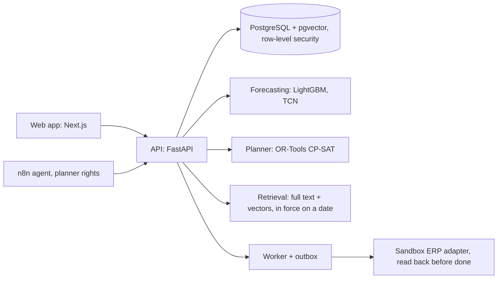

<!--
DRAFT for the owner and team (Phase 8, 8A WP9a, 2026-11-10). Not approved.
- Every number on a slide is copied from docs/course/metrics.md (generated from the study registry). Do not type a new
  number: regenerate metrics.md instead.
- Time limit, date and format of the Week 6 presentation are not known yet (open action 8A.1d). Read aloud at about
  130 words per minute and cut slides to fit once the limit is known.
- Images: only the title uses a generated illustration (D01). The closing illustration D06 is not used: the supplied
  file is truncated (owner to re-export). Charts, diagrams and screenshots are never generated.
- Export: npx @marp-team/marp-cli docs/course/interim-deck.md --pdf --pptx --allow-local-files (Mermaid diagrams are
  rendered separately before export).
-->

<!-- _class: cover -->
<!-- _paginate: false -->

# SupplyLens

Evidence-grounded inventory and procurement decisions

AI in Operations (MAIB AI 218) · Interim group presentation, Week 6

Krishna Mathur · Atharva Soundankar · Yash Petkar

<!--
Speaker notes (rubric: presentation skills). Introduce the team and the one-line promise: decide what to order, from
whom and why, and be able to prove it later. Who presents which slide: to be agreed by the team.
-->

---

## The problem: ordering decisions nobody can prove later

- A planner has to decide **what to order, from whom, and why**, under a budget, with supplier terms that change over time.
- Most tools give a number. They do not show **which forecast, which contract clause in force on that date, and which
  checks** the number came from, and they rarely stop a person from sending an order nobody approved.
- Operations KPIs at stake: **cost, service level and sustainability**, which pull against each other.

<!--
Rubric: content quality. Link to unit outcome A (optimise operations) and B (impact on the supply chain).
No numbers on this slide on purpose.
-->

---

## Data, and what it cannot tell us

| Source | What it is | Kind |
|---|---|---|
| UCI Online Retail II | Real sales of one online retailer (CC BY 4.0) | Observed |
| Stock, suppliers, agreements, costs | Generated, labelled **SIMULATED** in every screen | Simulated |
| CUAD, ACORD | Public contract clauses with expert labels | Human-labelled |
| AI4I 2020, generated images | Studies only (maintenance, inspection) | Published synthetic / simulated |

- The sales data has **no stock, no lead times and no lost sales**: every planning result is a simulation.
- No study measures a real business outcome yet.

<!--
Rubric: content quality. Say this before any result: it is the honest frame for everything after it.
-->

---

## Architecture

Approvals are bound to the exact payload and expire; purchasing stays deterministic.

<!--
Rubric: application of techniques. Point at where AI sits (forecasting, retrieval, optional local cited answers) and
where it deliberately does not (the order itself is deterministic and approved by a person).
-->

---

## The spine: one shortage, end to end

1. **Forecast** shows a product will run short (Forecast lab).
2. **Exception** appears on Overview and Exceptions.
3. **Investigator** gathers stock, terms in force, open orders.
4. **Planner** (CP-SAT) proposes an order within budget and constraints.
5. **Evidence packet**: data cutoff, forecast version, cited clause, constraint checks.
6. **Approval** by a second person, bound to that exact plan.
7. **Order** sent to the sandbox ERP and **read back** before it counts as done.

<!--
Rubric: application of techniques and content quality. This is the live demo path (docs/course/demo-script-5min.md).
-->

---

## Result 1 — cost, service and CO2 (E1)

Simulation: real UCI scope; terms, stock, lanes, CO2 factors and unit weights assumed. Run E1-20261026T200641Z.

- Scope: **40** products, **23,980** units required, binding weekly budget.
- No CO2 cap: **4,565** units short. CO2 capped at **0.95** of that: **4,574** short — a small cut is almost free.
- Registry headline: *halving CO2 costs 13.8 points of coverage.*
- An evolutionary search (NSGA-II) reaches **0.9807–0.9849** of the exact front's hypervolume: close, but not exact.

<!--
Rubric: application of techniques (multi-objective optimisation, Week 2). Every number here is in metrics.md, E1.
-->

---

## Result 2 — visual inspection at goods-in (QC1)

Simulation: generated images, assumed costs. Run QC1-20261030T193358Z.

- **3,000** test images, **862** with a defect.
- A small CNN separates defects with AUC **0.9972**; hand-made features reach **0.9462**.
- Checking only what the CNN flags: recall **0.9872** (**11** escaped defects), cost **£419.4** against **£900** for
  inspecting everything.
- Generated images are easier than photographs: this is a method check, not a factory result.

<!--
Rubric: application of techniques (computer vision for quality control, Weeks 6 and 9). Numbers from metrics.md, QC1.
-->

---

## Result 3 — scheduling the receiving floor (JS1)

Simulation: real UCI volumes; routes and handling times assumed. Run JS1-20261030T191602Z.

- **9** receiving-floor instances; exact CP-SAT against the dispatch rules a floor lead would use.
- Schedules from the rules are longer on average: FIFO **0.1191**, SPT **0.1111**, EDD **0.13**, most work remaining
  **0.1138** (share longer than CP-SAT).
- CP-SAT proved **7** of **9** schedules optimal; on the published ft06 check it finds the known optimum, **55**.

<!--
Rubric: application of techniques (job shop scheduling, Week 5). Numbers from metrics.md, JS1.
Note for the owner: the brief suggested S2 ("accuracy is not value") here; S2 is marked exploratory in the registry, so
it is not in metrics.md and is not shown. Promote it in the registry first if the team wants it.
-->

---

## Plan to the final project

- Weeks 6 to 10: LSTM forecasting; class imbalance and group parity; ETA and last-mile routing (dataset approval
  pending); AI document extraction from contracts; an order and stock status assistant with a ticket hand-off;
  a red-team test of generated answers.
- Weeks 10 to 12: responsible-AI document and model cards, business case with a sensitivity table, final deck and
  report.
- Negative results are kept (for example: weather did not clearly improve the forecasts, W1).

<!--
Rubric: content quality. Plan comes from the Phase 8 brief (sessions 8B and 8C).
-->

---

<!-- _paginate: false -->

## Team

Krishna Mathur · Atharva Soundankar · Yash Petkar

Questions?

AI-use statement: `docs/course/ai-use-statement.md`

<!--
Rubric: team collaboration. Who did what is recorded in CONTRIBUTIONS.md once the team agrees it (names only for now).
Closing illustration D06 left out: the supplied file is truncated (owner to re-export).
-->
